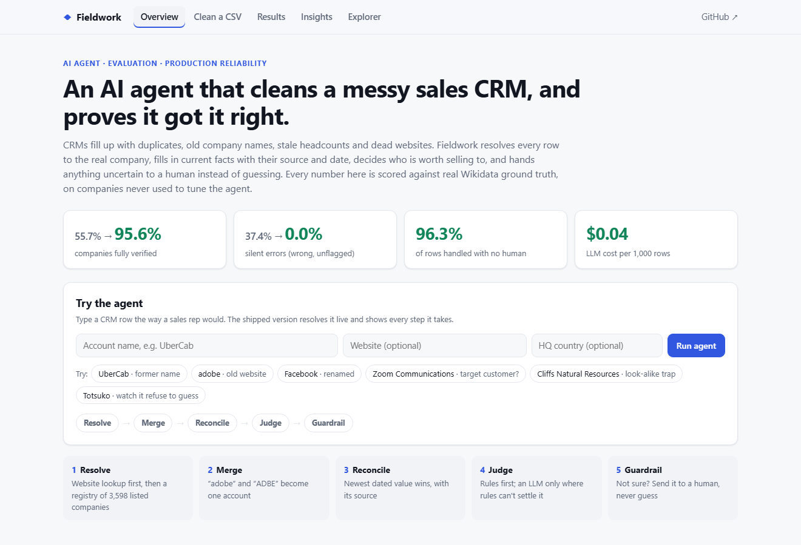
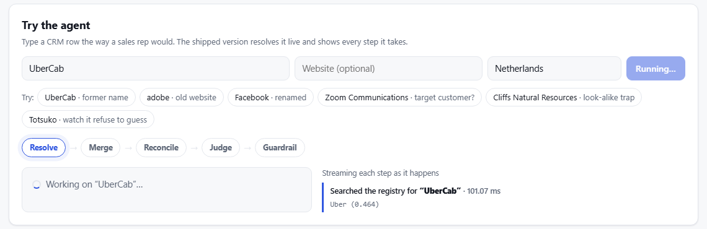
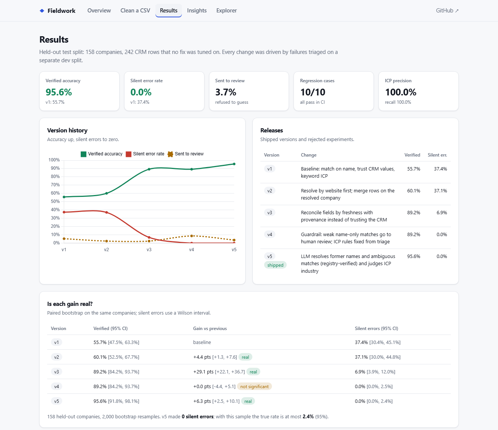
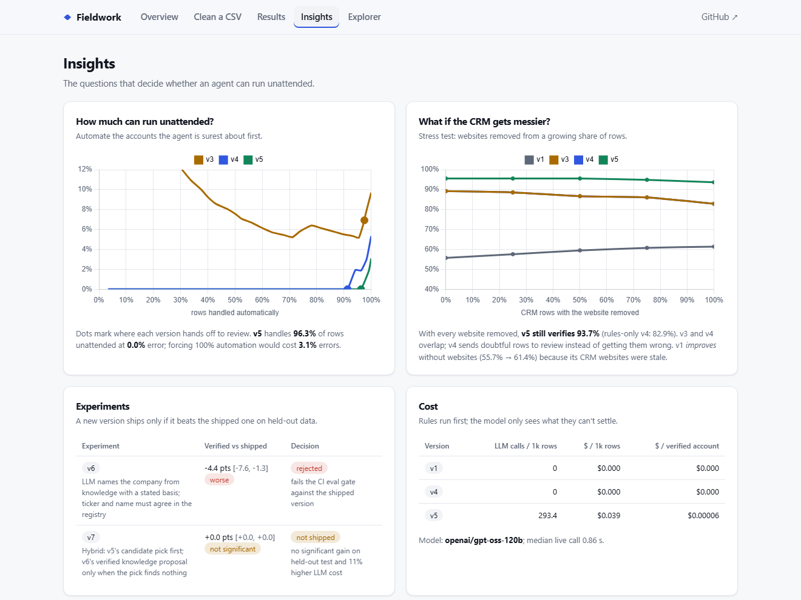
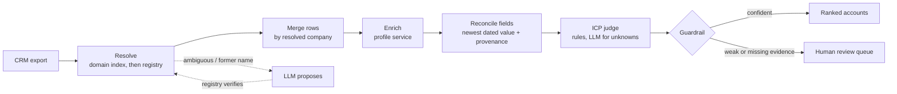
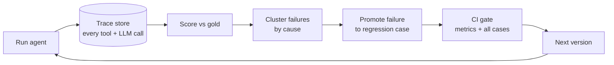
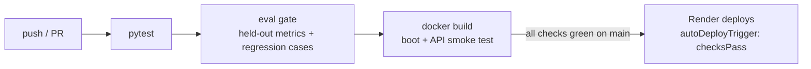

# Fieldwork

[](https://github.com/jhaashutosh07/Fieldwork/actions/workflows/ci-cd.yml)
[](https://render.com/deploy?repo=https://github.com/jhaashutosh07/Fieldwork)

**Live demo: https://fieldwork-ayde.onrender.com** · try it: [UberCab](https://fieldwork-ayde.onrender.com/?try=UberCab&country=Netherlands) · [Facebook](https://fieldwork-ayde.onrender.com/?try=Facebook) · [adobe + old website](https://fieldwork-ayde.onrender.com/?try=adobe&site=business.adobe.com&country=United%20States)
(free hosting: the first visit can take ~1 minute to wake up)

**An account-research agent that cleans a messy CRM export into a verified, ICP-ranked account list, plus the eval
flywheel that took it from 55.7% to 95.6% verified accuracy and from 37.4% to 0% silent errors.**

Most agents demo well and fail quietly in production. Fieldwork is built around the loop that closes that gap:
every run is traced, every miss is scored against real ground truth and clustered by cause, and any failure can be
promoted into a regression test that CI enforces before the next version ships.



## In 30 seconds

| | |
|---|---|
| **Problem** | Sales CRMs are full of duplicates, old company names, stale headcounts and dead websites. Agents that "clean" them tend to be confidently wrong. |
| **What it does** | Resolves each row to the real company, merges duplicates, fills current facts with source and date, scores fit, and sends anything uncertain to a human. |
| **Proof** | Scored against real Wikidata ground truth on 158 held-out companies: **55.7% → 95.6%** verified (significant, paired bootstrap), **37.4% → 0%** silent errors (≤ 2.4% at 95%), **96.3%** of rows automated, **$0.04 per 1,000 rows**. |
| **Engineering** | Tool-using agent with LLM fallback (Groq, `gpt-oss-120b`), record/replay LLM cache, trace store, failure clustering, regression suite, CI eval gate that blocked a regressing change, Docker, CI-gated deploys. |
| **Try it** | The dashboard has a **Try the agent** box: type `UberCab` or `Facebook` and watch every step. Share a run with `/?try=UberCab&country=Netherlands`. |



## Results (held-out test split: 158 companies, 242 CRM rows)

| Version | What changed | Verified accuracy | Silent error rate | Sent to review | Regression cases |
|---|---|---|---|---|---|
| v1 | Match on name, trust CRM values, keyword ICP | 55.7% | 37.4% | 5.4% | 0/10 |
| v2 | Resolve by website first; merge rows on the resolved company | 60.1% | 37.1% | 2.5% | 0/10 |
| v3 | Reconcile fields by freshness, with provenance | 89.2% | 6.9% | 2.5% | 5/10 |
| v4 | Guardrail: weak name-only matches go to human review; ICP rules from triage | 89.2% | 0.0% | 8.7% | 10/10 |
| v5 ✅ shipped | LLM resolves former names (registry-verified) and judges unknown industries | **95.6%** | **0.0%** | **3.7%** | 10/10 |
| v6 ❌ rejected | LLM names the company from its own knowledge; ticker + name must agree | 91.1% | 0.7% | 6.2% | 10/10 |
| v7 ⏸ not shipped | Hybrid of v5 and v6 | 95.6% | 0.0% | 3.7% | 10/10 |

v5 uses `openai/gpt-oss-120b` on Groq: 169 LLM calls across both splits, about **$0.02** in total, because rules run
first and the model is only asked about the cases rules can't settle.

- **Verified accuracy** counts a company only if exactly one asserted account covers all its CRM rows *and* the entity,
  website, headcount, country and ICP verdict are all correct. Plausible-looking output earns nothing.
- **Silent error rate** is the share of accounts the agent asserted *without* flagging them that are wrong. That is the
  number that decides whether an agent can run unattended.
- Every fix was driven by failures triaged on the **dev** split; the table is the **test** split, which no fix was tuned
  on. The full story of each version is in [docs/CHANGELOG.md](docs/CHANGELOG.md).



## Insights

`fieldwork insights` turns the scores into answers to the questions that decide whether an agent can be trusted
(`evals/insights.json`, rendered on the dashboard):

| Question | Answer (held-out test) |
|---|---|
| **Is each gain real, or noise?** | Paired bootstrap on the same 158 companies: v3 **+29.1 pts [+22.1, +36.7]**, v5 over v4 **+6.3 pts [+2.5, +10.1]**, both significant. v4 adds no accuracy (+0.0, n.s.); its job was cutting silent errors to zero. |
| **How sure is "0% silent errors"?** | 0 wrong out of 155 asserted accounts. A Wilson interval puts the true rate at **≤ 2.4%** (95%). A bootstrap would wrongly report [0, 0]. |
| **How much can run unattended?** | v5 handles **96.3%** of rows automatically at **0%** error; forcing 100% automation would cost **3.1%** errors. That's the price of removing the review queue. |
| **What if the CRM gets messier?** | With **every** website removed, v5 still verifies **93.7%** (rules-only v4: 82.9%). v1 *improves* as websites vanish (55.7% → 61.4%): its CRM websites were stale, so trusting old data was worse than having none. |
| **What does it cost?** | v5: 293 LLM calls and **$0.039 per 1,000 CRM rows**, about **$0.00006 per verified account**; median live call 0.86 s. |
| **Did every idea ship?** | No. **v6 was rejected by the CI gate** (−4.4 pts [−7.6, −1.3]): it looked better on dev but failed on held-out data (shared tickers, renamed subsidiaries). **v7 tied v5** (+0.0, n.s.) at 11% more LLM cost, so it wasn't shipped. |



## The task

A sales team exports its CRM: 602 rows for 409 real US-listed companies. Like every real CRM, it is messy:

| Problem in the export | Example (all real values) |
|---|---|
| Duplicates under different spellings | `adobe`, `ADBE` |
| Former names and aliases | `Applied Molecular Genetics` (Amgen), `Cliffs Natural Resources` (Cleveland-Cliffs) |
| Stale headcounts | Consolidated Edison's 2010 headcount, typed in years ago |
| Old websites | `business.adobe.com`, retired domains |
| Look-alike companies in the registry | `Nuclear Corporation of America` vs *Reinsurance Group of America* |

The agent must return one account per real company, with the current website, headcount and country (each with a
source and date), an ICP verdict, and a ranking, or **send the account to human review** when it can't be sure.

ICP: *B2B technology vendors (software, cloud, IT services, security, data, semiconductors, networking)
headquartered in the US with 1,000–100,000 employees.*

## How it works





- **Tools**: a registry search over 3,598 NYSE/NASDAQ-listed companies (look-alike names included), a domain index
  of current and former websites, and a company-profile service. Each call is traced with its latency.
- **Guardrails**: the LLM never asserts an entity on its own. A suggested name must resolve cleanly in the registry
  before it is used, and any account with weak evidence or a missing field goes to review.
- **Record/replay LLM**: live calls (Groq or OpenAI) are recorded to `data/llm_cache.jsonl`; CI replays them, so evals
  are deterministic and cost nothing.

## Where the data comes from

Everything is real, and nothing is invented.

- `data/snapshot/` is a frozen pull from the **Wikidata Query Service** (CC0): 3,598 listed companies, plus full
  profiles (dated headcounts, current and former websites, industries, aliases) for 409 of them.
  `python -m fieldwork.data.build_snapshot` refreshes it.
- `data/dataset/crm_export.csv` is generated from that snapshot by `fieldwork/data/make_dataset.py` (seeded). The
  generator only chooses *which real value* a rep would have typed: an alias, an older dated headcount, a retired
  website.
- `data/dataset/gold.json` holds the answers: the current preferred website, the latest dated headcount, the listed
  countries, and an ICP verdict. Industry labels were judged by hand against the ICP above.

The profile service is treated as the source of truth for field values. The hard parts are the ones real CRMs make
hard: entity resolution, merging, knowing when not to guess, and ICP judgment.

## Quickstart

```bash
pip install -e ".[dev]"

fieldwork run --version v1 --split dev     # run + metrics + failure clusters
fieldwork triage <run_id>                  # failures grouped by cause, with ids
fieldwork promote <failure_id>             # freeze a failure as a regression case
fieldwork gate                             # what CI runs: held-out metrics + every case
fieldwork history                          # evaluate every version -> evals/history.json
fieldwork insights                         # CIs, significance, automation curve, cost, stress test
fieldwork serve                            # dashboard at http://127.0.0.1:8000

pytest -q
```

Record the LLM version (Groq's free tier is enough):

```bash
export GROQ_API_KEY=...
FIELDWORK_LLM=groq fieldwork history       # live calls, recorded to data/llm_cache.jsonl
fieldwork gate --llm replay --update-baseline
```

## CI/CD and hosting



- `.github/workflows/ci-cd.yml` runs the tests, the eval gate (with recorded LLM answers, so it is free and
  deterministic) and a container smoke test on every push and pull request. The gate result is written to the job
  summary.
- `render.yaml` deploys the Docker image to Render, but **only after those checks pass on `main`**. A change that
  makes the agent worse fails the gate and never reaches the live site.
- The hosted demo runs in public mode: runs use recorded LLM answers only (no live API spend), one run every 5 seconds
  per visitor, and storage is capped. On boot it evaluates every version so the dashboard is populated.

With Docker (Postgres trace store):

```bash
docker compose up --build                  # http://localhost:8000
```

## API

| Method | Path | Purpose |
|---|---|---|
| `POST` | `/api/try` | run the shipped agent on one CRM row you type; returns the account and every step |
| `POST` | `/api/runs` | run a version on a split (offline or replayed LLM) |
| `GET` | `/api/runs/{id}` | metrics + failure clusters |
| `GET` | `/api/runs/{id}/failures?signature=` | failures with expected vs got |
| `GET` | `/api/runs/{id}/trace?account=` | every step the agent took for an account |
| `POST` | `/api/failures/{id}/promote` | freeze a failure as a regression case |
| `GET` | `/api/history`, `/api/regressions` | version history, regression suite |

## Layout

```
fieldwork/
  agent.py      pipeline + versioned policies (v1..v5)
  tools.py      registry search, domain index, profile service
  llm.py        provider client with record/replay cache
  evals.py      gold scoring, verified accuracy, silent errors, failure signatures
  flywheel.py   run, promote, regression check, CI gate, history
  insights.py   bootstrap/Wilson intervals, paired significance, risk-coverage, cost, stress test
  store.py      trace store (SQLite or Postgres via FIELDWORK_DB)
  api.py        FastAPI service; static/index.html is the dashboard
  data/         snapshot builder and dataset generator
evals/          regressions/*.json, baseline.json, history.json
.github/workflows/ci-cd.yml   tests -> eval gate -> docker smoke test
render.yaml                  Render blueprint (deploys only when checks pass)
```

## Limits and next steps

- v5's review queue (3.7%) is mostly old names the model doesn't know (Totsuko = Sony, Valley Falls = Berkshire
  Hathaway). Feeding reviewer decisions back as gold would turn that queue into training data.
- With 158 test companies, "0 silent errors" bounds the true rate at 2.4%, not 0. Tighter claims need a bigger
  held-out set.
- ICP labels are one person's judgment of an industry taxonomy. A second labeller and an agreement score would make
  the ICP metrics sturdier.
- Next: feed human review decisions back as new gold, so the review queue itself becomes training data for the flywheel.

## License

MIT
