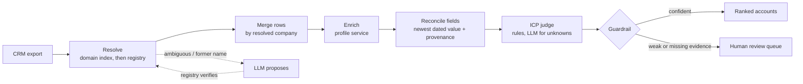
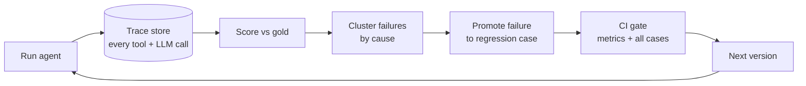
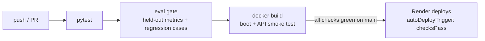

# Fieldwork

[](https://github.com/jhaashutosh07/fieldwork/actions/workflows/ci-cd.yml)
[](https://render.com/deploy?repo=https://github.com/jhaashutosh07/fieldwork)

**An account-research agent that cleans a messy CRM export into a verified, ICP-ranked account list, plus the eval
flywheel that took it from 55.7% to 89.2% verified accuracy and from 37.4% to 0% silent errors.**

Most agents demo well and fail quietly in production. Fieldwork is built around the loop that closes that gap:
every run is traced, every miss is scored against real ground truth and clustered by cause, and any failure can be
promoted into a regression test that CI enforces before the next version ships.


## Results (held-out test split: 158 companies, 242 CRM rows)

| Version | What changed | Verified accuracy | Silent error rate | Sent to review | Regression cases |
|---|---|---|---|---|---|
| v1 | Match on name, trust CRM values, keyword ICP | 55.7% | 37.4% | 5.4% | 0/9 |
| v2 | Resolve by website first; merge rows on the resolved company | 60.1% | 37.1% | 2.5% | 0/9 |
| v3 | Reconcile fields by freshness, with provenance | 89.2% | 6.9% | 2.5% | 4/9 |
| v4 | Guardrail: weak name-only matches go to human review; ICP rules from triage | **89.2%** | **0.0%** | 8.7% | 9/9 |
| v5 | LLM resolves former names (registry-verified) and judges unknown industries | *pending recording* | | | |

- **Verified accuracy** counts a company only if exactly one asserted account covers all its CRM rows *and* the entity,
  website, headcount, country and ICP verdict are all correct. Plausible-looking output earns nothing.
- **Silent error rate** is the share of accounts the agent asserted *without* flagging them that are wrong. That is the
  number that decides whether an agent can run unattended.
- Every fix was driven by failures triaged on the **dev** split; the table is the **test** split, which no fix was tuned
  on. The full story of each version is in [docs/CHANGELOG.md](docs/CHANGELOG.md).

## The task

A sales team exports its CRM: 602 rows for 409 real US-listed companies. Like every real CRM, it is messy:

| Problem in the export | Example (all real values) |
|---|---|
| Duplicates under different spellings | `adobe`, `ADBE` |
| Former names and aliases | `Applied Molecular Genetics` (Amgen), `Cliffs Natural Resources` (Cleveland-Cliffs) |
| Stale headcounts | Consolidated Edison's 2010 headcount, typed in years ago |
| Old websites | `business.adobe.com`, retired domains |
| Look-alike companies in the registry | `Nuclear Corporation of America` vs *Reinsurance Group of America* |

The agent must return one account per real company, with the current website, headcount and country (each with a
source and date), an ICP verdict, and a ranking, or **send the account to human review** when it can't be sure.

ICP: *B2B technology vendors (software, cloud, IT services, security, data, semiconductors, networking)
headquartered in the US with 1,000–100,000 employees.*

## How it works





- **Tools**: a registry search over 3,598 NYSE/NASDAQ-listed companies (look-alike names included), a domain index
  of current and former websites, and a company-profile service. Each call is traced with its latency.
- **Guardrails**: the LLM never asserts an entity on its own. A suggested name must resolve cleanly in the registry
  before it is used, and any account with weak evidence or a missing field goes to review.
- **Record/replay LLM**: live calls (Groq or OpenAI) are recorded to `data/llm_cache.jsonl`; CI replays them, so evals
  are deterministic and cost nothing.

## Where the data comes from

Everything is real, and nothing is invented.

- `data/snapshot/` is a frozen pull from the **Wikidata Query Service** (CC0): 3,598 listed companies, plus full
  profiles (dated headcounts, current and former websites, industries, aliases) for 409 of them.
  `python -m fieldwork.data.build_snapshot` refreshes it.
- `data/dataset/crm_export.csv` is generated from that snapshot by `fieldwork/data/make_dataset.py` (seeded). The
  generator only chooses *which real value* a rep would have typed: an alias, an older dated headcount, a retired
  website.
- `data/dataset/gold.json` holds the answers: the current preferred website, the latest dated headcount, the listed
  countries, and an ICP verdict. Industry labels were judged by hand against the ICP above.

The profile service is treated as the source of truth for field values. The hard parts are the ones real CRMs make
hard: entity resolution, merging, knowing when not to guess, and ICP judgment.

## Quickstart

```bash
pip install -e ".[dev]"

fieldwork run --version v1 --split dev     # run + metrics + failure clusters
fieldwork triage <run_id>                  # failures grouped by cause, with ids
fieldwork promote <failure_id>             # freeze a failure as a regression case
fieldwork gate                             # what CI runs: held-out metrics + every case
fieldwork history                          # evaluate every version -> evals/history.json
fieldwork serve                            # dashboard at http://127.0.0.1:8000

pytest -q
```

Record the LLM version (Groq's free tier is enough):

```bash
export GROQ_API_KEY=...
FIELDWORK_LLM=groq fieldwork history       # live calls, recorded to data/llm_cache.jsonl
fieldwork gate --llm replay --update-baseline
```

## CI/CD and hosting



- `.github/workflows/ci-cd.yml` runs the tests, the eval gate (with recorded LLM answers, so it is free and
  deterministic) and a container smoke test on every push and pull request. The gate result is written to the job
  summary.
- `render.yaml` deploys the Docker image to Render, but **only after those checks pass on `main`**. A change that
  makes the agent worse fails the gate and never reaches the live site.
- The hosted demo runs in public mode: runs use recorded LLM answers only (no live API spend), one run every 5 seconds
  per visitor, and storage is capped. On boot it evaluates every version so the dashboard is populated.

With Docker (Postgres trace store):

```bash
docker compose up --build                  # http://localhost:8000
```

## API

| Method | Path | Purpose |
|---|---|---|
| `POST` | `/api/runs` | run a version on a split (offline or replayed LLM) |
| `GET` | `/api/runs/{id}` | metrics + failure clusters |
| `GET` | `/api/runs/{id}/failures?signature=` | failures with expected vs got |
| `GET` | `/api/runs/{id}/trace?account=` | every step the agent took for an account |
| `POST` | `/api/failures/{id}/promote` | freeze a failure as a regression case |
| `GET` | `/api/history`, `/api/regressions` | version history, regression suite |

## Layout

```
fieldwork/
  agent.py      pipeline + versioned policies (v1..v5)
  tools.py      registry search, domain index, profile service
  llm.py        provider client with record/replay cache
  evals.py      gold scoring, verified accuracy, silent errors, failure signatures
  flywheel.py   run, promote, regression check, CI gate, history
  store.py      trace store (SQLite or Postgres via FIELDWORK_DB)
  api.py        FastAPI service; static/index.html is the dashboard
  data/         snapshot builder and dataset generator
evals/          regressions/*.json, baseline.json, history.json
.github/workflows/ci-cd.yml   tests -> eval gate -> docker smoke test
render.yaml                  Render blueprint (deploys only when checks pass)
```

## Limits and next steps

- v4 buys 0% silent errors with an 8.7% review rate. Most of that queue is former names with no website, which is
  exactly what v5 targets.
- ICP labels are one person's judgment of an industry taxonomy. A second labeller and an agreement score would make
  the ICP metrics sturdier.
- Next: feed human review decisions back as new gold, so the review queue itself becomes training data for the flywheel.

## License

MIT
